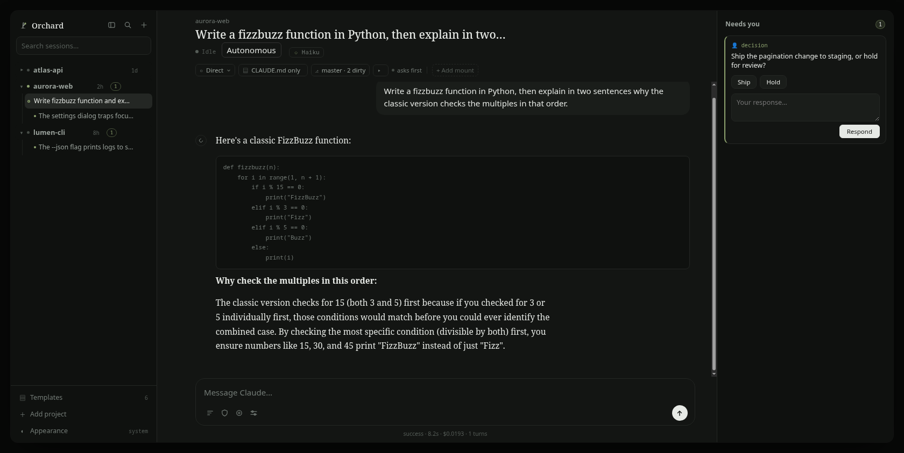
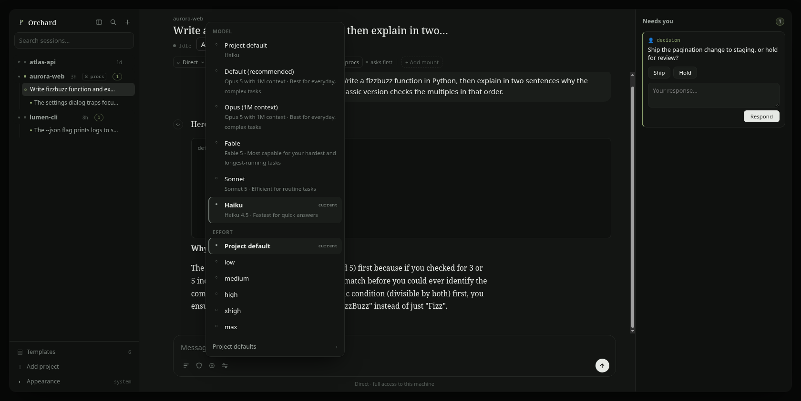
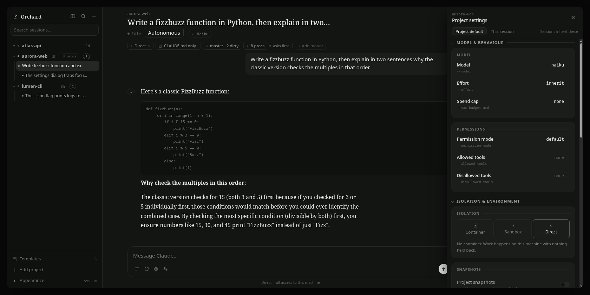

# Orchard

Orchard is a local, single-user web dashboard for running AI coding sessions across several
projects at once. It drives the provider CLIs you already have (Claude Code, OpenAI Codex) and
their existing subscriptions; it does not call provider APIs or store keys.



## Who it's for

One developer, on one machine, running coding-agent sessions in more than one repository and tired
of juggling terminal windows and re-pasting the same project instructions into each session. It is
local-only tooling: a single user, no multi-tenant or remote-access story (see
[Security](#security)).

## Why it exists

A few problems come up once you run agents across many projects:

- The same project instructions (working agreement, conventions, routing, reply format) get
  re-explained to every session. Orchard composes one instruction bundle per project from Markdown
  templates, so editing a template changes every session in that project.
- Watching several sessions means several terminal windows. Orchard lists projects and sessions in
  a sidebar, renders each transcript in the main pane, and collects anything that needs an answer
  in one rail.
- Sandboxing a session should not require writing a Dockerfile. Isolation is a per-project setting:
  run on the host, or in a Docker container with memory limits and dropped capabilities.
- Notes made during a session are lost when it ends. Each project gets an append-only ticket board
  under `docs/bugs/`, injected into every session's prompt, so context carries across sessions.

## Requirements

- **Linux, or Windows via WSL2.** The server shells out to Unix tools with no portable fallback:
  `git`, `rg` (ripgrep, for session search), and `cp --reflink=always` (for snapshots). On native
  Windows the server boots but these features fail individually; run it under WSL2 instead. macOS
  is untested.
- **Node 23 or newer.** Node runs the TypeScript sources directly, so there is no build step.
- **A provider CLI on `PATH`, signed in.** Claude Code (`claude`, with an Anthropic Pro/Max plan)
  or OpenAI Codex (`codex login`, with a ChatGPT Plus or higher plan). See
  [docs/PROVIDERS.md](docs/PROVIDERS.md).
- Optional: `systemd` for the background service and restart survival; Docker for container
  isolation (the first container run builds a local image, ~1 GB).

## Install and run

```sh
npm ci       # first time only; installs from the committed lockfile
npm start    # serves http://127.0.0.1:4317
```

`PORT` and `CLAUDE_STATION_DATA` override the defaults. Application data (project registry,
templates, snapshots) lives under your XDG data directory, outside the repository.

To run it as a background service, copy `deploy/claude-station.service` into your systemd user unit
directory, adjust the repository path inside it, then:

```sh
systemctl --user enable --now claude-station
```

(Under WSL2, the background service needs `systemd=true` in `/etc/wsl.conf`.)

New to it? [docs/guide/](docs/guide/README.md) walks through the workflow with screenshots, and the
same guide is served inside the app.

## Features

- **Queued input.** Type while a turn is running; messages queue and deliver in order, or
  force-send.
- **Subagents as rows.** Spawned agents render as live rows and always settle to completed, failed
  or cut rather than spinning indefinitely.
- **Multiple providers.** Pick the provider at launch; a header chip shows the model the session
  reported.
- **A rail for anything that needs you.** A session's questions surface as cards in one rail, so you
  don't hunt for which session is waiting.
- **Restart survival.** The server can restart while sessions keep running; live turns are drained
  and re-adopted.
- **Headless dispatch.** `scripts/dispatch.mjs` runs a one-shot task through either provider and
  prints the result; `scripts/gatekeeper.mjs` reviews a commit range from a fresh context on the
  other provider.
- **Instruction templates.** Markdown with frontmatter, composed per project, with a preview
  endpoint.
- **Project snapshots.** Per-session undo via `cp --reflink` copies, near-instant and near-zero
  extra bytes until files diverge; fails loudly if reflink is unavailable (btrfs/XFS).
- **A narrow git panel.** Changes, branches, history and stashes. No discard, merge, rebase or
  per-hunk staging; history and stashes are read-only.
- **Response-format hook.** An advisory, per-project hook nudges a session's final reply toward a
  short digest format.



Per-project settings (model, permission mode, isolation, snapshots, integrations) live in a drawer,
with a "this session" scope for a single run.



## Configuration

Set these in the environment where the server starts (a systemd unit drop-in, not an interactive
shell — a value exported into a shell is lost on the next reboot):

| Variable | Purpose |
| --- | --- |
| `PORT` | Listen port (default 4317). |
| `CLAUDE_STATION_DATA` | Application data directory (default under XDG data home). |
| `CLAUDE_STATION_ALLOWED_ORIGINS` | Extra allowed WebSocket origins. |
| `CLAUDE_STATION_ALLOWED_HOSTS` | Extra allowed HTTP/WebSocket hosts. |
| `CLAUDE_STATION_SBMCP_REPO` | Path to the persistent-browser MCP repo (see Integrations). |

The `CLAUDE_STATION_*` prefix and the `claude-station` service name are the project's former name,
kept on anything that identifies stored state (the systemd unit, these variables, the data
directory, Docker image and container labels) so that renaming would not orphan existing data.

## Optional integrations

Per-project toggles; none are bundled.

- **Serena.** Symbol-level code navigation over a language server, run via `uvx`
  ([oraios/serena](https://github.com/oraios/serena)).
- **Playwright.** `@playwright/mcp` via `npx` — an ephemeral headless browser with a clean profile.
- **Persistent browser profile.** A separate, unpublished local project that keeps a browser profile
  between sessions for sites you stay signed into. Point `CLAUDE_STATION_SBMCP_REPO` at its checkout;
  if unset, the toggle degrades with a message and the session still starts without the browser
  tools.
- **OpenAI dispatch.** The headless dispatch and gatekeeper runners can target the Codex CLI, e.g.
  to review one provider's work from the other.

## Security

Single-user, local-only tooling.

- **Localhost binding.** The server binds `127.0.0.1` and has no authentication of its own (out of
  scope). Do not port-forward it or place it behind a reverse proxy.
- **Origin and host allowlists.** A browser's same-origin policy does not gate WebSocket
  *establishment*, so the WebSocket upgrade enforces an origin allowlist and both HTTP and WebSocket
  enforce a host allowlist — a guard against DNS rebinding. Both are extendable via the environment
  variables above.
- **Permission modes.** Sessions run under the provider CLI's normal permission gate. Skipping
  approvals is an explicit per-project or per-session choice, never a global default, and is flagged
  as a raised risk outside a container.
- **Isolation tiers.** `direct` (default, on the host) and `container` (Docker, with resource limits
  on by default). A `sandbox` (bubblewrap) tier is designed but not implemented and returns an error
  rather than degrading silently.
- **Docker socket.** Mounting it into a container is off by default and takes two deliberate actions;
  on a rootful daemon it is equivalent to root on the host.
- **Credentials.** No API keys are read or stored; sessions use the provider CLI's own sign-in.

## Verify

```sh
npm run typecheck                # tsc --noEmit
node scripts/verify.ts --offline # API + agent bridge, no model calls
npm run verify:ui                # drives the real UI in a real DOM against a real server
npm run verify                   # full end-to-end pass (calls the model, costs tokens)
npm run gate                     # the pre-commit gate
```

Each harness spawns a real server on a scratch data directory and a free port, reports what it
observed, and stops what it started.

## Layout

| Path | Purpose |
| --- | --- |
| `src/server/index.ts` | HTTP and WebSocket server, JSON API, static UI |
| `src/server/agent-bridge.ts` | Wraps the provider runtimes; normalises messages into one event type |
| `src/server/runtime/` | Provider runtimes (Claude Code, Codex) behind one interface |
| `src/server/snapshots.ts` | Per-session project snapshots via reflink, and restore |
| `public/` | The UI (vanilla JavaScript, no framework, no bundler) |
| `scripts/` | Verification harnesses, dispatch runner, gatekeeper, onboarding, gates |
| `docs/guide/` | The user guide, also served inside the app |

## Methodology

Orchard is built around a written working agreement for multi-agent development — how sessions are
orchestrated, how work is verified, and how context accumulates on tickets. It lives in
[docs/prompts/WORKING_AGREEMENT.v4.md](docs/prompts/WORKING_AGREEMENT.v4.md) and is injected into
the sessions Orchard launches.

## Status

A personal project developed in the open, built for one person on one machine, and changing quickly.
Interfaces change without deprecation periods, and `docs/bugs/` is the record of what works and what
does not. Out of scope by design: authentication, multiple users, a file manager, a preview proxy,
and API-key authentication.

Issues are welcome; pull requests are discussed in an issue first — see
[CONTRIBUTING.md](CONTRIBUTING.md).

## License

Released under the [PolyForm Noncommercial License 1.0.0](LICENSE). You may use, modify and share it
for any noncommercial purpose, including use by charities, schools, and public research and
government bodies. Commercial use requires a separate license, arranged by opening an issue on this
repository.
</content>
</invoke>
